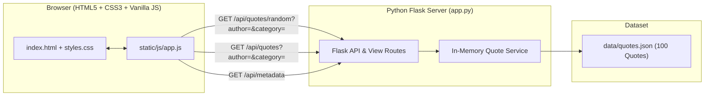

# Famous Quotes Web Application — Implementation Plan

## Goal Description
Build a clean, responsive web application using **Python (Flask)**, **HTML5**, **CSS3**, and **plain Vanilla JavaScript** that serves a curated dataset of **100 well-known quotes**. Users can:
1. **Display a random quote** at any time (with smooth transitions, copy-to-clipboard, and non-repeating consecutive selection).
2. **Search by author** (case-insensitive partial or full author name matching, plus quick-select author suggestions).
3. **Filter by category** (interactive category pills/dropdown covering categories such as *Wisdom*, *Inspiration*, *Philosophy*, *Science*, *Leadership*, *Literature*, *Life*, *Courage*, *Humor*, and *Success*).
4. **Combine filters** to either browse all matching quotes or draw a random quote specifically from the active author/category filter.

---

## User Review Required

> [!NOTE]
> **Environment Setup (`uv`)**: The workspace currently has no files and Windows does not have a global system Python on `PATH`, but `uv` (`C:\Users\akana\.local\bin\uv.exe`) is installed. During execution, we will initialize a local virtual environment (`.venv`) and install `flask` and `pytest` using `uv` (alongside a standard `requirements.txt`).

---

## Open Questions

> [!IMPORTANT]
> Before we start writing the code, please let me know if you'd like to adjust any of these defaults (or simply click **Proceed** if the defaults look good):
> 1. **Search Results Display**: Our plan includes both a hero **Random Quote Spotlight** card at the top (which can draw a random quote from all 100 quotes or from your active filter) *and* a **Matching Quotes** grid below it that updates live as you search by author or select a category. Does this dual view work well for you?
> 2. **Categories**: Do you have any specific categories you must include, or is our curated set (*Wisdom*, *Inspiration*, *Philosophy*, *Science*, *Leadership*, *Literature*, *Life*, *Courage*, *Humor*, *Success*) good?

---

## Architecture Overview



---

## Proposed Changes

### Project Configuration & Dependencies

#### [NEW] requirements.txt
Standard Python dependency list for Flask and testing:
```text
Flask>=3.0.0
pytest>=8.0.0
```

---

### Quote Dataset

#### [NEW] data/quotes.json
A structured JSON file containing **100 well-known quotes** from historical and modern figures (e.g., Albert Einstein, Maya Angelou, Marcus Aurelius, Oscar Wilde, Marie Curie, Aristotle, Mark Twain, Nelson Mandela, Confucius, Seneca, etc.).

Each quote entry follows this schema:
```json
[
  {
    "id": 1,
    "text": "The only way to do great work is to love what you do.",
    "author": "Steve Jobs",
    "categories": ["Inspiration", "Success", "Leadership"]
  }
]
```

---

### Flask Backend

#### [NEW] app.py
Flask application serving both the frontend template and RESTful JSON endpoints:

- `GET /`: Renders `templates/index.html`.
- `GET /api/metadata`: Returns all unique categories (sorted, with quote counts) and all unique authors (sorted, with quote counts) so the UI can populate category badges and author autocomplete suggestions.
- `GET /api/quotes`: Filters the 100 quotes based on optional query parameters:
  - `author`: Case-insensitive substring match on the quote's `author` field.
  - `category`: Case-insensitive match against any category in the quote's `categories` array.
  - Returns `{"count": <int>, "quotes": [...]}`.
- `GET /api/quotes/random`: Returns a single randomly chosen quote matching optional `author` and `category` filters. Accepts an optional `exclude_id` query parameter so clicking "New Random Quote" avoids repeating the currently displayed quote when more than one quote matches. Returns HTTP `404` with a friendly message if no quotes match the filter criteria.

```python
@app.route("/api/quotes/random", methods=["GET"])
def get_random_quote():
    author = request.args.get("author", "").strip()
    category = request.args.get("category", "").strip()
    exclude_id = request.args.get("exclude_id", type=int)

    filtered = filter_quotes(QUOTES, author=author, category=category)
    if not filtered:
        return jsonify({"error": "No quotes found matching the given filters."}), 404

    candidates = [q for q in filtered if q["id"] != exclude_id] if len(filtered) > 1 and exclude_id is not None else filtered
    return jsonify(random.choice(candidates))
```

---

### Frontend (HTML, CSS, Vanilla JavaScript)

#### [NEW] templates/index.html
Semantic HTML5 single-page interface featuring:
- **Header**: Application title, subtitle, and dataset stats badge (`100 Famous Quotes`).
- **Random Quote Spotlight Section**:
  - Large typographic quote display (`blockquote`), author attribution, and clickable category tags.
  - Action buttons: **"Random Quote"** (draws from current filters or all 100 quotes), **"Copy Quote"**, and a toggle/indicator showing whether the randomizer is scoped to active filters.
- **Search & Filter Bar**:
  - **Author Search Input**: Search box with `<datalist>` autocomplete populated from `/api/metadata` and live debounced input filtering.
  - **Category Filter Pills**: Interactive horizontal pill bar ("All Categories" + each category with count) to filter with one click.
  - **Clear Filters Button**: Resets author query and selected category.
- **Quotes Results Grid**:
  - Displays the count of matching quotes and renders cards for each matching quote.
  - Clicking an author name or category badge on any quote card automatically sets that filter.

---

#### [NEW] static/css/styles.css
Modern, responsive CSS using custom properties (CSS variables), Flexbox, and CSS Grid:
- Clean editorial typography for quotes, subtle elevation shadows, smooth fade transitions when loading a new random quote, and responsive breakpoints for mobile and desktop.

---

#### [NEW] static/js/app.js
Plain vanilla JavaScript (`fetch` API, DOM manipulation, no external libraries):
- Initializes application state (`selectedCategory`, `authorQuery`, `currentRandomQuoteId`).
- Fetches metadata (`/api/metadata`), an initial random quote (`/api/quotes/random`), and the quote list (`/api/quotes`).
- Implements debounced listener on the author input (`200ms`) and click handlers on category pills.
- Updates both the matching quotes grid and allows fetching a new random quote scoped to the active author/category filters.

---

### Automated Test Suite

#### [NEW] tests/test_app.py
Automated `pytest` suite verifying:
1. `data/quotes.json` loads cleanly and contains **exactly 100 quotes**, each with unique `id`, non-empty `text`, non-empty `author`, and at least one category in `categories`.
2. `GET /` returns `200 OK` and renders the HTML shell.
3. `GET /api/metadata` returns accurate author and category lists and counts.
4. `GET /api/quotes/random` returns a valid random quote, respects `author` and `category` filters, respects `exclude_id`, and returns `404` for non-existent filters.
5. `GET /api/quotes` filters accurately by `author` (case-insensitive partial and exact), by `category` (case-insensitive), and by both combined.

---

## Verification Plan

### Automated Tests
Run the test suite via `pytest`:
```powershell
uv run pytest -v
```

### Manual / Live Server Verification
1. Start the Flask development server and verify HTTP responses against `/` and `/api/*`.
2. Confirm the user can run the app locally with:
   ```powershell
   uv run flask --app app run --debug
   ```
   and open `http://127.0.0.1:5000` in their browser.
